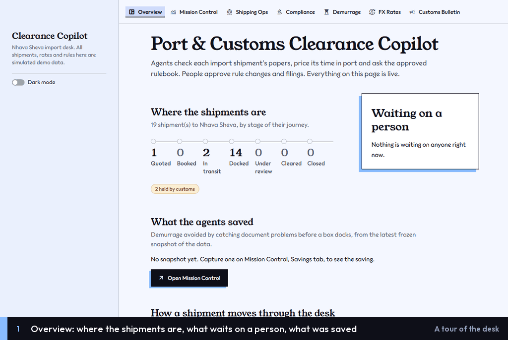

# Port & Customs Clearance Copilot

A locally run multi-agent system (LangGraph + MCP) for an import desk at Nhava Sheva (JNPT,
`INNSA`). It cross-checks a shipment's documents against three editable data sources — port
demurrage tariffs, FX-rate rules and a compliance rulebook — and produces discrepancy flags, a
demurrage/hold-risk estimate, a clearance checklist and a human-gated clearance workflow. A
scheduled agent watches a (simulated) customs bulletin and emails a reviewer. Every agent action
and human decision lands in an audit trail; Mission Control shows it all, plus the before/after
ROI of the agents.

- Specs: [`docs/`](docs/) — start with [`problem_statement.md`](docs/problem_statement.md) and
  [`architecture.md`](docs/architecture.md).
- Demo walk-through: [`docs/DEMO_SCRIPT.md`](docs/DEMO_SCRIPT.md).
- Learn every path to clearance with fifteen hands-on cases: [`docs/WALKTHROUGH.md`](docs/WALKTHROUGH.md).


## See it work

Real sessions on the dashboards, recorded on a freshly seeded copy of the demo data: real
clicks, the agents really running (their waits are shortened), each step captioned at the
bottom. The cases (WT01, WT02, ...) are the ones in [`docs/WALKTHROUGH.md`](docs/WALKTHROUGH.md),
where every step is written out.

**A tour of the desk.** Overview, then each page, then dark mode.



**The straight path (WT01).** The GIF at the top: open a shipment, analyse it (a dry run:
nothing changes), start a clearance run, approve the filing, Cleared.

<details>
<summary><b>Fix the papers (WT02)</b>: a run is blocked because the packing list counts 470 and
everything else 500; amend it, refile.</summary>


</details>

<details>
<summary><b>Missing data (WT09)</b>: a 20ft reefer with no port tariff, so the stay cannot be
priced; add the tariff on the Demurrage page, refile.</summary>


</details>

<details>
<summary><b>A new rule waits for review (WT11)</b>: the bulletin publishes a rule, the regulatory
watch proposes it, the clearance run waits until a reviewer approves it.</summary>


</details>

<details>
<summary><b>A rejected filing (WT12)</b>: the reviewer rejects with a reason; the certificate is
attached and a new run is approved.</summary>


</details>

<details>
<summary><b>Held by customs (WT08)</b>: a held box is not fileable; once the hold is lifted it goes
back under review and is filed.</summary>


</details>

<details>
<summary><b>Every step on record</b>: the clearance runs, the audit trail filtered to the
supervisor, and the counts on Overview.</summary>


</details>

## What you need

- **Python 3.11 or newer** (developed on 3.13).
- **PostgreSQL 15 or newer**, installed natively and running on `localhost:5432` (developed on
  18), and the password of its superuser (`postgres`) — used once, by the setup script.
- About **3 GB** of disk and an internet connection for the first install (CPU PyTorch and
  the two retrieval models, ~525 MB, downloaded on first use into the Hugging Face cache).
- Optional: a **Groq API key** (free tier) for LLM-written explanations and answers — without
  one every agent uses its deterministic fallback; a **Google Cloud project** for real email
  ([`docs/setup_gmail.md`](docs/setup_gmail.md)) — without it emails are written as `.eml`
  files to `outbox/`.

No Docker: ChromaDB runs inside the Python process; `docker-compose.yml` is only for GitHub CI.
Commands below are for Windows PowerShell; on macOS/Linux use `.venv/bin/python` instead of
`.\.venv\Scripts\python.exe` (and likewise for the other tools).

## Set up (once)

All Python packages go into the project's own `.venv`, never into the global Python.

```powershell
# 1. Get the code and create the virtual environment
git clone <repository-url> customs-copilot
cd customs-copilot
python -m venv .venv
.\.venv\Scripts\python.exe -m pip install --upgrade pip

# 2. Install: CPU-only PyTorch first (the default wheels bundle CUDA), then the project
.\.venv\Scripts\python.exe -m pip install torch --index-url https://download.pytorch.org/whl/cpu
.\.venv\Scripts\python.exe -m pip install -e ".[dev,models]"

# 3. Configuration
Copy-Item .env.example .env
```

Edit `.env` and set:

| Key | Value |
|---|---|
| `POSTGRES_PASSWORD` | a new password of your choice for the app's database role (`customs`) |
| `REVIEWERS` | the people who may approve rule changes and filings, e.g. `Your Name <you@example.com>` (separate several with `;`) |
| `GROQ_API_KEY` | optional — your Groq key |

Leave every other key empty to use the defaults (they are listed and explained in
`.env.example`).

```powershell
# 4. Create the database role, the app database and the test database
#    (psql is found automatically; it asks for the postgres superuser password)
.\.venv\Scripts\python.exe -m scripts.setup_local_db

# 5. Create the tables
.\.venv\Scripts\alembic.exe upgrade head

# 6. Load the demo data — the JNPT case study: 4 shipments and their documents, port tariffs,
#    FX rates, the customs bulletin and the approved rulebook (and its search index).
#    The first run downloads the retrieval models (~525 MB). Safe to re-run.
.\.venv\Scripts\python.exe -m scripts.seed
```

A warning that you are "sending unauthenticated requests to the HF Hub" is harmless.

## Run

```powershell
.\.venv\Scripts\streamlit.exe run dashboards/Home.py
```

Open <http://localhost:8501> (the browser is not opened for you — settings in
`.streamlit/config.toml`). Stop with `Ctrl+C`. Times are shown in IST; everything is stored in
UTC.

| Page | What it is for |
|---|---|
| **Overview** | The front page: where the shipments are, what waits on a person, what the agents saved |
| **Mission Control** | Analyse every shipment, follow the audit trail live, before/after savings (ROI) |
| Shipping Ops | Shipments, documents, status; analyse one shipment; supervised clearance runs |
| Demurrage | Port tariffs (free days, daily rate) per container type and period |
| FX Rates | Spot, locked and gazetted exchange rates; resolve a rate for a lifecycle stage |
| Compliance | Review pending rule changes, the rulebook in force, ask the rulebook (with citations) |
| Customs Bulletin | The simulated external bulletin; run the regulatory watch scan |

The dashboards open in a light theme; the *Dark mode* toggle in the sidebar switches every
page to dark for the session. The visual system is written down in [`DESIGN.md`](DESIGN.md).

Then follow [`docs/DEMO_SCRIPT.md`](docs/DEMO_SCRIPT.md). To learn the whole desk by doing,
seed the fifteen walkthrough cases (each stops a shipment a different way) and follow
[`docs/WALKTHROUGH.md`](docs/WALKTHROUGH.md):

```powershell
.\.venv\Scripts\python.exe -m scripts.seed_walkthrough
```

### Optional: real email and the scheduled watch

- Real email: follow [`docs/setup_gmail.md`](docs/setup_gmail.md), then set
  `EMAIL_BACKEND=gmail` and `REVIEWER_EMAIL` in `.env`.
- The regulatory watch runs on demand from Customs Bulletin → *Scans and changes* → **Run
  scheduled scan now**, or on a schedule in its own terminal:

  ```powershell
  .\.venv\Scripts\python.exe -m scheduler.watch_scheduler          # every WATCH_SCAN_INTERVAL_MINUTES (15)
  .\.venv\Scripts\python.exe -m scheduler.watch_scheduler --once   # one scan now
  ```

## Command-line tools

Everything the dashboards do is also available as a script (JSON output):

```powershell
.\.venv\Scripts\python.exe -m scripts.demo_jnpt --as-of 2026-09-28    # the whole case study + ROI
.\.venv\Scripts\python.exe -m scripts.verify_documents --all          # document verification agent
.\.venv\Scripts\python.exe -m scripts.analyse_shipments --all         # the full analysis pipeline
.\.venv\Scripts\python.exe -m scripts.clearance start --container MSKU7001001   # supervised run
.\.venv\Scripts\python.exe -m scripts.clearance --help                # list/show/resume/approve/...
.\.venv\Scripts\python.exe -m scripts.roi --help                      # ROI snapshots + compare
.\.venv\Scripts\python.exe -m scripts.index_rulebook                  # rebuild the search index
```

The six MCP servers start automatically when an agent needs them; to inspect one by hand:
`.\.venv\Scripts\python.exe -m mcp_servers.fx_rates_mcp.server` (stdio).

## Start over

To return to the original demo data (this deletes the app database and everything in it —
you are asked to type its name):

```powershell
.\.venv\Scripts\python.exe -m scripts.setup_local_db --reset
.\.venv\Scripts\alembic.exe upgrade head
.\.venv\Scripts\python.exe -m scripts.seed
.\.venv\Scripts\python.exe -m scripts.index_rulebook    # drop search entries of deleted rules
```

## Quality checks

```powershell
.\.venv\Scripts\ruff.exe check .
.\.venv\Scripts\black.exe --check .
.\.venv\Scripts\mypy.exe .
.\.venv\Scripts\python.exe -m scripts.scan_secrets   # nothing secret tracked by git
.\.venv\Scripts\pytest.exe                           # everything (~4 min); DB tests use POSTGRES_TEST_DB
.\.venv\Scripts\pytest.exe -m "not db and not models"   # no database, no model download
```

The test database is wiped and rebuilt on every run; tests never call an LLM or send email.
Tests marked `models` load the real retrieval models.

## Troubleshooting

- **`psql not found`** — pass its path: `python -m scripts.setup_local_db --psql "C:\Program
  Files\PostgreSQL\18\bin\psql.exe"`.
- **`password authentication failed for user "customs"`** — `POSTGRES_PASSWORD` in `.env`
  changed after setup; re-run `scripts.setup_local_db` (it re-syncs the role's password).
- **Port 8501 in use** — another Streamlit is running; stop it or add `--server.port 8502`.
- **Analyses show "data gaps" for FX** — the demo FX rates cover 2026-07-01 to 2026-10-31. Use
  an analysis date in that window (the dashboards default to today); the demo uses 2026-09-28.
- **A clearance run is stuck in `running`** (the process was closed mid-run) — Shipping Ops →
  the shipment → *Clearance* → *Abandon this run*, then start a new one.

## Project layout

```
config/        settings (.env)          models/      ORM + Pydantic records
services/      the single service layer (dashboards, MCP servers and agents all use it)
mcp_servers/   six MCP servers          agents/      LangGraph agents + the supervisor
rag/           retrieval (BM25 + BGE + rerank)   roi/  the ROI calculator
scheduler/     regulatory watch job     integrations/  email (outbox, Gmail)
dashboards/    Streamlit views          scripts/     setup, seed and CLI tools
alembic/       migrations (0001..)      tests/       pytest suite      docs/  specs
```

New migrations are hand-written and prefixed with the phase that introduced them
(`alembic revision --rev-id 0010 -m "<slug>"`), then checked with `alembic check`.
